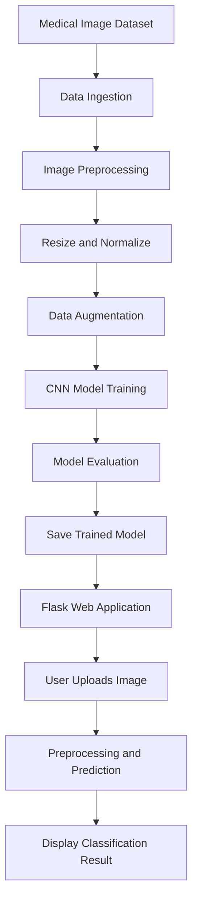

# 🩺 Kidney Disease Classification Using Deep Learning

A deep learning project that classifies kidney disease from medical images using Convolutional Neural Networks (CNNs) and image preprocessing techniques. The project includes an end-to-end pipeline for data preparation, model training, evaluation, and web-based deployment.

**Live Demo:** [Try the Application](https://kidney-disease-classification-project-viaa.onrender.com/)

**GitHub Repository:** [View Source Code](https://github.com/TusharK93/Kidney-Disease-Classification-Project---Deep-Learning)

---

## 📌 Project Overview

Kidney disease diagnosis can involve analyzing medical images, a process that may be time-consuming and requires specialized expertise. This project explores how deep learning can assist image classification by learning visual patterns from labeled training data.

The application uses a CNN-based image classification workflow and provides a web interface for submitting images and viewing predictions.

> **Important:** This project is for educational and research purposes. Its predictions are not a substitute for professional medical diagnosis.

## 🎯 Problem Statement

Manual interpretation of medical images can require significant time and expertise. An automated classification model can help explore patterns in image data and support research into computer-assisted medical image analysis.

The main objectives are to:

- Prepare and preprocess medical images for model training.
- Train a deep learning model to distinguish between image classes.
- Evaluate classification performance using standard metrics.
- Make the trained model accessible through a web application.

## 💡 Proposed Solution

The project implements an end-to-end deep learning workflow with:

- Image resizing and normalization.
- Data augmentation to improve training diversity.
- CNN-based image feature learning and classification.
- Model evaluation using accuracy and F1-score.
- A Flask application for interacting with the trained model.
- Deployment through Render.

## ✨ Key Features

- **Deep Learning:** CNN-based image classification.
- **Image Preprocessing:** Standardized image dimensions and pixel values.
- **Data Augmentation:** Helps improve model robustness when configured in the training pipeline.
- **Model Evaluation:** Uses classification metrics to assess performance.
- **Experiment Tracking:** MLflow integration for tracking experiments, if enabled in the configured workflow.
- **Data Versioning:** Optional DVC integration for reproducible data and pipeline management.
- **Web Deployment:** Flask application hosted on Render.
- **Modular Structure:** Configuration, components, and pipeline code organized for maintainability.

## 🏗️ Project Architecture



## 🛠️ Tech Stack

| Category | Technologies |
|---|---|
| Programming Language | Python |
| Deep Learning | TensorFlow / Keras |
| Image Processing | Image preprocessing and augmentation |
| Experiment Tracking | MLflow |
| Data Versioning | DVC (optional) |
| Web Framework | Flask |
| Deployment | Render |
| Configuration | YAML |
| Development Tools | Git, GitHub, Conda |

*Confirm each optional tool against your current repository configuration before publishing.*

## 🔄 Workflow

### 1. Data Ingestion
Load the dataset and organize the images and labels for subsequent processing.

### 2. Data Preprocessing
Resize images to the expected input dimensions and normalize pixel values to make them suitable for model training.

### 3. Data Augmentation
Apply configured image transformations to increase training diversity and help reduce overfitting.

### 4. Model Training
Train a CNN to learn image features and predict the relevant class.

### 5. Model Evaluation
Evaluate the model on held-out data using metrics such as accuracy, precision, recall, and F1-score, where available.

### 6. Model Serving
Load the trained model into the Flask application, preprocess user-uploaded images consistently, and return a prediction.

## 📊 Model Performance

The reported project results are:

| Metric | Reported Result |
|---|---:|
| Accuracy | 94% |
| F1-Score | 92% |

These figures should be interpreted in the context of the dataset, class distribution, and evaluation method. They are reported project results, not independently verified clinical performance.

## 🚀 Live Deployment

Try the deployed application:

**[Kidney Disease Classification — Live Demo](https://kidney-disease-classification-project-viaa.onrender.com/)**

The application provides a web-based interface for submitting an image and viewing the model's classification output.

*Availability may depend on the hosting service.*

## ⚙️ Installation and Setup

### Prerequisites

- Python 3.8, as specified in the original project setup
- Conda or another Python environment manager
- Git

### 1. Clone the Repository

```bash
git clone https://github.com/TusharK93/Kidney-Disease-Classification-Project---Deep-Learning.git
cd Kidney-Disease-Classification-Project---Deep-Learning
```

### 2. Create and Activate the Environment

```bash
conda create --name kidney-classification python=3.8 -y
conda activate kidney-classification
```

### 3. Install Dependencies

```bash
pip install -r requirements.txt
```

### 4. Configure the Project

Review the configuration files provided in the repository, such as:

- `config.yaml`
- `params.yaml`
- `secrets.yaml`, if applicable

Use your own local environment variables or secrets configuration where needed. **Never commit passwords, API keys, access tokens, or other credentials to GitHub.**

### 5. Run the Application

If `app.py` is the configured Flask entry point:

```bash
python app.py
```

Open the local address printed by Flask in your browser. Verify the actual entry point and configuration requirements in your repository before running the application.

## 📁 Project Structure

The project follows a modular organization. The exact files may vary by repository version.

```text
Kidney-Disease-Classification-Project---Deep-Learning/
├── config/
├── research/
├── src/
│   └── cnnClassifier/
│       ├── components/
│       ├── config/
│       ├── entity/
│       ├── pipeline/
│       └── utils/
├── config.yaml
├── params.yaml
├── requirements.txt
├── main.py
├── dvc.yaml
├── app.py
└── README.md
```

## 📈 Potential Improvements

- Evaluate performance on larger, independent datasets.
- Report per-class precision, recall, and confusion matrices.
- Add explainability methods such as Grad-CAM to visualize image regions influencing predictions.
- Improve model monitoring and inference logging.
- Add automated tests and a continuous integration pipeline.
- Package the application with Docker for consistent deployment.
- Conduct appropriate clinical validation before considering any real-world medical use.

## 🧠 Skills Demonstrated

- Deep Learning and CNNs
- Medical Image Classification
- Image Preprocessing and Augmentation
- Model Training and Evaluation
- Python and TensorFlow/Keras
- Flask Application Development
- MLflow Experiment Tracking
- DVC-Based Workflow Management
- Model Deployment
- Modular ML Pipeline Design

## 👨‍💻 Author

**Tushar Kumawat**

- GitHub: [@TusharK93](https://github.com/TusharK93)
- Project Repository: [Kidney Disease Classification](https://github.com/TusharK93/Kidney-Disease-Classification-Project---Deep-Learning)
- Live Demo: [Open Application](https://kidney-disease-classification-project-viaa.onrender.com/)

## 📄 License

Add a `LICENSE` file to the repository to specify how others may use, modify, and distribute this project. Until then, do not assume the repository is licensed for reuse.
<p align="center">
  
</p>
