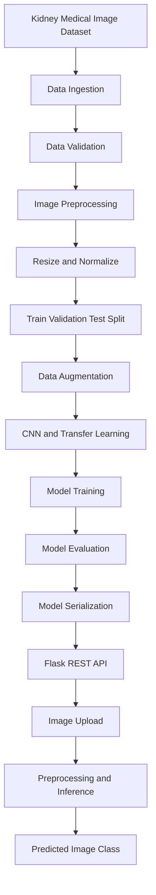

# 🩺 Kidney Disease Classification Using Deep Learning

An end-to-end Deep Learning and Computer Vision project that classifies kidney medical images using Convolutional Neural Networks (CNNs) and transfer learning. The project covers image preprocessing, data augmentation, model training, evaluation, and deployment through a Flask REST API.

🔗 **Live Demo:** [Try the Application](https://kidney-disease-classification-project-viaa.onrender.com/)

📂 **GitHub Repository:** [Kidney Disease Classification — Deep Learning](https://github.com/TusharK93/Kidney-Disease-Classification-Project---Deep-Learning)

---

## 📌 Project Overview

Manual medical image screening can be time-consuming and resource-intensive. Deep Learning and Computer Vision offer opportunities to automate preliminary image classification and support more efficient medical image analysis.

The **Kidney Disease Classification** project uses CNN-based image classification and transfer learning to identify patterns in kidney medical images and predict the corresponding image category.

The project demonstrates an end-to-end Deep Learning workflow, from data ingestion and image preprocessing to model evaluation, inference, and cloud deployment.

**Note:** This application is an AI classification proof of concept, not a clinically validated diagnostic system. Its predictions should not be used as a substitute for professional medical evaluation.

## 🎯 Problem Statement

Manual analysis of medical images can involve significant time and effort, particularly when large volumes of images need to be screened.

Key challenges include:

- Time-consuming manual image screening.
- Difficulty scaling image analysis across large datasets.
- The need for consistent image preprocessing and classification.
- The effort required to train, evaluate, and deploy Deep Learning models.
- The need for accessible prediction interfaces for trained models.

**Objective:** Develop an automated image classification pipeline that can categorize kidney medical images and reduce manual screening effort during preliminary analysis.

## 💡 Solution

Built an end-to-end Deep Learning pipeline using CNN-based classification and transfer learning.

The solution incorporates multiple image-processing and model-development techniques, including:

- Image resizing and normalization.
- Data splitting for model development and evaluation.
- Data augmentation to improve training diversity.
- CNN-based feature extraction and classification.
- Transfer learning to leverage pretrained representations.
- Model training and performance evaluation.
- A prediction pipeline for new images.
- A Flask REST API for image-based inference.
- Cloud deployment on Render.

## ⚙️ Key Features

- **End-to-End Deep Learning Pipeline:** Organizes the workflow from data ingestion to prediction.
- **Medical Image Classification:** Processes kidney images and predicts their learned class labels.
- **Image Preprocessing:** Standardizes image dimensions and pixel values.
- **Data Augmentation:** Introduces image variations to support model generalization.
- **Transfer Learning:** Uses pretrained representations to support feature learning.
- **Model Evaluation:** Measures classification performance using relevant evaluation metrics.
- **Modular Architecture:** Separates configuration, components, and pipeline execution.
- **Centralized Configuration:** Supports configuration-driven pipeline management.
- **Exception Handling and Logging:** Helps track execution and diagnose failures.
- **REST API:** Provides an interface for image-based predictions.
- **Cloud Deployment:** Makes the application accessible through Render.

## 🏗️ Project Architecture

The following diagram illustrates the high-level Deep Learning workflow.



*This is a conceptual architecture. The actual model components, class labels, and pipeline execution order depend on the implementation in the repository.*

## 🛠️ Technology Stack

| Category | Technologies |
|---|---|
| Programming Language | Python |
| Deep Learning | TensorFlow, Keras |
| Computer Vision | CNNs, Transfer Learning |
| Data Processing | NumPy, Pandas |
| Image Processing | Image resizing, normalization, augmentation |
| API Development | Flask |
| Experiment Tracking | MLflow |
| Pipeline Management | DVC (optional, depending on configuration) |
| Deployment | Render, Docker |
| Version Control | Git, GitHub |
| Engineering Practices | Modular components, centralized configuration, logging, exception handling |

## 🧠 Deep Learning Workflow

The project follows a structured image-classification lifecycle.

1. **Data Ingestion:** Load the kidney image dataset.
2. **Data Validation:** Check the dataset and expected input structure.
3. **Image Preprocessing:** Resize images and normalize pixel values.
4. **Data Splitting:** Prepare separate subsets for training, validation, and testing.
5. **Data Augmentation:** Apply suitable transformations to training images.
6. **Feature Learning:** Extract image features using a CNN or pretrained model.
7. **Transfer Learning:** Reuse pretrained representations where applicable.
8. **Model Training:** Train the classification model on labeled images.
9. **Model Evaluation:** Assess performance on held-out data.
10. **Model Serialization:** Save the trained model for inference.
11. **API Development:** Expose the model through Flask.
12. **Deployment:** Deploy the prediction application on Render.

## 📊 Results & Business Impact

The project achieved the following reported classification results:

<box border radius="xl" padding={4} gap={3}>
  <grid columns={2} gap={4}>
    <grid-item>
      <text color="secondary" size="sm">Classification Accuracy</text>
      <title size="2xl" color="success">94%</title>
    </grid-item>
    <grid-item>
      <text color="secondary" size="sm">F1 Score</text>
      <title size="2xl" color="success">92%</title>
    </grid-item>
  </grid>
</box>

### Business impact

- **Automated image classification:** Reduces the need to manually classify each image.
- **Efficient screening workflows:** Supports faster preliminary processing of medical images.
- **Consistent predictions:** Applies the same trained model to incoming images.
- **Accessible inference:** Makes the model available through a cloud-hosted application.

*These are reported project evaluation metrics. Actual performance depends on the dataset, class distribution, evaluation methodology, and quality of incoming images. The results do not establish clinical accuracy or diagnostic suitability.*

## 📈 Model Evaluation

The following metrics are useful for evaluating the image classification model:

- **Accuracy:** Percentage of correctly classified images.
- **Precision:** Measures how often predictions for a class are correct.
- **Recall:** Measures how many actual examples of a class are identified.
- **F1 Score:** Balances precision and recall.
- **Confusion Matrix:** Shows correct and incorrect classifications across classes.

For medical image classification, per-class precision and recall are especially important because aggregate accuracy can hide errors affecting individual categories.

## 🚀 Live Deployment

The application is deployed on Render and provides a web-accessible interface for image-based inference.

- **Live Application:** [Kidney Disease Classification](https://kidney-disease-classification-project-viaa.onrender.com/)
- **Source Code:** [GitHub Repository](https://github.com/TusharK93/Kidney-Disease-Classification-Project---Deep-Learning)

The Flask API processes uploaded images using the deployed model and returns predictions according to the application's implementation.

## ⚙️ Getting Started

Follow these steps to run the project locally.

### Prerequisites

- Python 3.8 or the version supported by the repository.
- Conda or Python virtual environment.
- Git.
- Required Python dependencies.
- The dataset and trained model artifacts, if not included in the repository.

### Step 1: Clone the repository

```bash
git clone https://github.com/TusharK93/Kidney-Disease-Classification-Project---Deep-Learning.git

cd Kidney-Disease-Classification-Project---Deep-Learning
```

### Step 2: Create a Conda environment

The original project instructions use Python 3.8.

```bash
conda create -n cnncls python=3.8 -y
conda activate cnncls
```

If your installed TensorFlow or other dependencies require a different Python version, use a compatible version specified by the project configuration.

### Step 3: Install dependencies

```bash
pip install -r requirements.txt
```

### Step 4: Configure the project

Depending on the repository's implementation, review and update the following configuration files:

- `config.yaml` — application and pipeline configuration.
- `params.yaml` — model and training parameters.
- `secrets.yaml` — optional secrets configuration; never commit real credentials.
- DVC configuration — dataset and pipeline versioning, if enabled.

The exact file locations may vary according to the project structure.

### Step 5: Run the application

```bash
python app.py
```

Open the local URL displayed in the terminal to access the application.

The actual port and startup command depend on the Flask configuration in the repository.

## 📉 MLflow Experiment Tracking

MLflow can be used to track model experiments and compare training runs, if configured in the project.

Typical capabilities include:

- Recording model parameters.
- Logging training and evaluation metrics.
- Comparing experiments.
- Tracking model artifacts.
- Supporting reproducibility during model development.

To launch the MLflow interface when MLflow is installed and configured:

```bash
mlflow ui
```

Then open:

```text
http://127.0.0.1:5000
```

If the project uses a remote MLflow tracking server, configure the tracking URI according to your environment.

**Security note:** Never publish tracking credentials, access tokens, or passwords in the README or source code. Use environment variables or a secure secrets manager for private configuration.

## 🔄 DVC Pipeline Management

If DVC is configured in the repository, it can help manage dataset versions and reproduce pipeline stages.

Common commands include:

```bash
dvc init
dvc repro
dvc dag
```

- `dvc init` initializes DVC in a repository.
- `dvc repro` executes the configured pipeline stages.
- `dvc dag` displays the pipeline dependency graph.

Run `dvc init` only when initializing DVC in a repository that has not already been configured. If the project already contains DVC metadata, use the existing configuration.

## 🐳 Docker Deployment

If the repository contains a `Dockerfile`, build and run the application using Docker.

### Build the image

```bash
docker build -t kidney-disease-classifier .
```

### Run the container

```bash
docker run -p 5000:5000 kidney-disease-classifier
```

Ensure that the container's startup command and exposed port match the actual Flask application configuration.

## 🔮 Future Enhancements

Potential improvements include:

- Evaluation on larger and more diverse image datasets.
- Per-class precision, recall, and confusion-matrix reporting.
- Explainability techniques such as Grad-CAM, where appropriate.
- Model versioning and automated retraining workflows.
- Input image validation and improved error reporting.
- API monitoring and prediction logging.
- Performance optimization for cloud inference.
- External clinical validation before any medical use.

## 🎓 Skills Demonstrated

- Deep Learning and Computer Vision.
- Convolutional Neural Networks.
- Transfer Learning.
- Medical Image Classification.
- Image Preprocessing and Augmentation.
- Model Training and Evaluation.
- TensorFlow and Keras.
- Flask REST API Development.
- MLflow Experiment Tracking.
- DVC Pipeline Management.
- Modular Software Architecture.
- Docker and Cloud Deployment.
- Git and GitHub.

## 💼 Why This Project Matters

Computer Vision can help automate image-processing workflows across healthcare and medical research. This project demonstrates the practical application of Deep Learning to image classification while covering the software engineering and deployment steps needed to expose a trained model through an API.

It showcases relevant skills for **Machine Learning Engineer, Deep Learning Engineer, Computer Vision Engineer, Data Scientist, and AI Engineer** roles.

The application should be considered a research or educational proof of concept unless its clinical safety and effectiveness have been independently validated.

## 👨‍💻 Author

**Tushar K**

- GitHub: [@TusharK93](https://github.com/TusharK93)

## 📄 License

Add a `LICENSE` file to the repository if you intend to distribute the project under an open-source license.

---

⭐ If you find this project interesting, consider starring the repository!

**Built with Python, TensorFlow, Keras, CNNs, Flask, and Computer Vision.**
